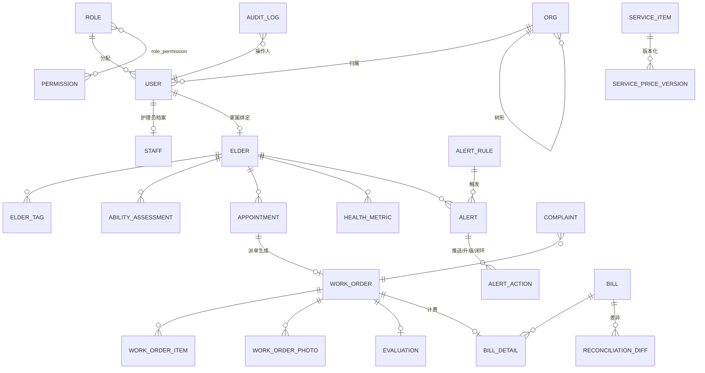
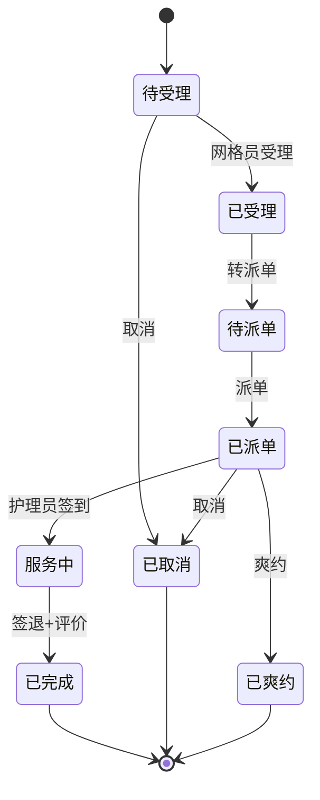

# 社区智慧养老服务与健康监测平台 · 系统设计文档

> 2026 年第四届大学生信息系统创新大赛 —— Python 编程巅峰赛决赛作品
> 版本：v1.0　|　技术栈：Python 3.12 + FastAPI + SQLAlchemy 2.0 + SQLite/PostgreSQL + Jinja2/ECharts

---

## 1. 需求与实现映射

### 1.1 功能清单（十项开发需求）

| # | 赛题需求 | 实现模块 | 关键接口 | 评分要素 |
|---|---|---|---|---|
| 1 | 老年人电子档案与能力评估 | `elders` + `archive_service` | `/api/v1/elders*` | 字段完整、加密脱敏、变更日志、多维筛选 |
| 2 | 服务项目与服务目录管理 | `catalog` + `catalog_service` | `/api/v1/catalog/*` | 价格版本化、历史工单不随调价变化 |
| 3 | 服务预约与受理 | `appointments` + `appointment_service` | `/api/v1/appointments*` | 三重校验、8 状态机、2 小时取消计费 |
| 4 | 智能派单与护理员调度 | `dispatch` + `algorithms/dispatch` | `/api/v1/dispatch/*` | 四因子加权、Top3 可解释、冲突检测、30 分钟顺延 |
| 5 | 上门服务执行与过程留痕 | `orders` + `order_service` | `/api/v1/orders/*` | 签到定位 200m、照片≤3、时长异常、异常上报 |
| 6 | 健康数据接入与分级预警 | `health` + `alerts` + `algorithms/alert_rules` | `/api/v1/health/*`、`/alerts/*` | 三类规则、三级预警、5 分钟推送、30 分钟升级、三态闭环 |
| 7 | 服务质量评价与投诉处理 | `quality` + `quality_service` | `/api/v1/quality/*` | 四项 5 星、≤3 星 48h 回访、绩效榜 |
| 8 | 费用结算与补贴核算 | `billing` + `algorithms/subsidy` | `/api/v1/billing/*` | 三方分账、四类差异拦截、>1% 复核、红冲 |
| 9 | 统计分析与可视化看板 | `stats` + `stats_service` | `/api/v1/stats/*` | 三类视角、≥4 类图表、Excel/CSV 导出 |
| 10 | 用户分级、权限、审计与备份 | `core/deps`、`core/audit`、`admin` | `/api/v1/admin/*` | RBAC + 数据范围、脱敏二次授权、审计链、30 版备份 |

### 1.2 六条业务流程（评分：业务流程闭环 15 分）

| 流程 | 入口 | 关键落点 | 异常与超时处理 |
|---|---|---|---|
| 预约与智能派单 | 家属提交预约 | 三重校验 → 待受理 → 待派单 → 候选 Top3 → 派单 | 30 分钟未接单自动顺延；手工改派强制填原因 |
| 上门服务执行与留痕 | 护理员签到 | 定位校验 → 逐项勾选 → 照片 → 签退 → 时长判定 | >200m 需说明；偏差 >30 分钟标记待抽查 |
| 健康异常预警与处置 | 指标上报 | 规则判定 → 推送 → 响应 → 闭环 | 红色 5 分钟推送；30 分钟升级街道；三态结论 |
| 服务评价与投诉 | 家属评价 | ≤3 星回访 → 投诉 → 复核 → 结论 | 48 小时回访时限；成立可退费/换人/扣分 |
| 费用结算与补贴 | 月度生成 | 快照计价 → 分账 → 差异校验 → 复核 → 缴费 | 差异率 >1% 强制人工复核 |
| 数据备份与恢复 | 每日 02:00 | 全量备份 → 保留 30 版 → 按时间点恢复 | 完整性校验 + 二次确认 + 核对报告 |

---

## 2. 系统架构

### 2.1 分层架构

```
┌──────────────────────────────────────────────────────────────┐
│ 表现层  Jinja2 + Bootstrap 5 + ECharts（适老化：大字号/高对比） │
│         角色化导航：老人/护理员/网格员/机构/街道/超管            │
├──────────────────────────────────────────────────────────────┤
│ 接口层  FastAPI Routers（/api/v1/*）· 统一响应 {code,message,data} │
│         依赖链：认证(JWT) → RBAC → 数据范围 → 审计              │
├──────────────────────────────────────────────────────────────┤
│ 应用层  services/：archive dispatch health quality billing       │
│         stats admin —— 业务规则、状态机、审计、通知、事务        │
├──────────────────────────────────────────────────────────────┤
│ 领域层  models/（40 张表）· state_machine（5 台状态机）          │
│         algorithms/（派单评分、预警规则、补贴分账）· 纯函数      │
├──────────────────────────────────────────────────────────────┤
│ 数据层  SQLAlchemy 2.0 Repository · 事务 · SQLite/PG 可切换      │
├──────────────────────────────────────────────────────────────┤
│ 横切    config（pydantic-settings 全外置）· security（AES-GCM/脱敏）│
│         audit（哈希链）· tasks（APScheduler）· 日志 · 备份      │
└──────────────────────────────────────────────────────────────┘
```

### 2.2 模块依赖关系

- 路由层只依赖「服务层 + 依赖注入」，不写业务规则；
- 算法层为纯函数（无 DB、无 IO），保证可单测、可复用、可解释；
- 服务层之间只允许**单向**调用（如 订单 → 预警评估；投诉 → 账单红冲），通过 `try/except ImportError` 解耦并行开发；
- 所有跨实体访问统一走 `app/core/deps.apply_scope` 注入数据范围，杜绝越权。

### 2.3 请求处理链（以派单为例）

```
POST /api/v1/dispatch/{appointment_id}/assign
  → JWT 解析（core/deps.get_current_user）
  → RBAC：require("order:dispatch")
  → 数据范围：apply_scope(..., user)（网格员仅本网格）
  → 状态机：APPOINTMENT.next("pending_dispatch","dispatch") → "dispatched"
  → 冲突检测：护理员时段无在途工单
  → 写 WorkOrder（价格版本快照）+ AppointmentLog + 审计(DISPATCH) + Notification
  → 返回 {code:0,data:{order_id,...}}
```

### 2.4 部署视图

```
┌──────────────┐     ┌──────────────────────────────┐
│ 浏览器（PC/移动）│────▶│ Nginx（可选）→ Uvicorn ×N      │
└──────────────┘     │   FastAPI app（无状态）        │
                     │   APScheduler（单实例）         │
                     └──────────┬───────────────────┘
                                │ SQLAlchemy
                     ┌──────────▼──────────┐   ┌──────────────┐
                     │ PostgreSQL 16 / SQLite │   │ 备份卷 data/  │
                     └─────────────────────┘   └──────────────┘
```

---

## 3. 数据模型

### 3.1 实体分组（40 张表）

| 分组 | 主要表 | 说明 |
|---|---|---|
| 组织与用户 | `org`、`user`、`role`、`permission`、`role_permission`、`staff` | 街道-社区-网格三级组织树；RBAC 多对多 |
| 档案 | `elder`、`elder_tag`、`elder_disease`、`elder_medication`、`ability_assessment`、`archive_change_log`、`access_grant` | 敏感字段密文 + HMAC 摘要；变更日志；二次授权 |
| 服务目录 | `service_item`、`service_price_version` | 价格版本化，工单快照 |
| 预约与工单 | `appointment`、`appointment_log`、`work_order`、`work_order_item`、`work_order_photo`、`work_order_track`、`anomaly_report` | 状态机 + 全链路留痕 |
| 健康与预警 | `health_metric`、`device`、`alert_rule`、`alert`、`alert_action` | 规则配置化；预警闭环流水 |
| 质量 | `evaluation`、`callback_task`、`complaint`、`staff_performance_monthly`、`notification` | 评价→回访→投诉→绩效 |
| 结算 | `subsidy_policy`、`bill`、`bill_detail`、`reconciliation_diff`、`payment_record` | 三方分账 + 差异清单 |
| 系统 | `audit_log`、`backup_record`、`config_item` | 哈希链审计；备份版本；运行期配置 |

### 3.2 ER 关系（核心链路）



### 3.3 五个关键设计决策

#### ① 价格版本化（历史工单不可变）

- `service_price_version` 记录每次调价：`(service_item_id, version, unit_price, effective_from, effective_to)`；
- `service_item.current_price_version_id` 指向当前版本；
- **工单落库时固化快照** `price_version_id + unit_price + quantity + amount`；
- 结论：调价只影响新工单，历史结算金额永不变动（赛题硬性要求）。

#### ② 状态机集中管理（状态不可跳跃）

- 五台状态机（预约/工单/预警/投诉/账单）统一在 `app/core/state_machine.py` 用 `{from: {action: to}}` 表驱动；
- 任何流转必须 `MACHINE.next(current, action)`，非法流转抛 `Conflict(409, code=INVALID_TRANSITION)`；
- 每次流转伴随日志表（`appointment_log` / `alert_action`）与审计，保证可追溯。

#### ③ 敏感字段加密 + 可检索

- 身份证/手机号/住址：AES-256-GCM 加密存 `*_enc`（随机 nonce，密文含 nonce）；
- 同时存 HMAC-SHA256 摘要 `*_hash`，用于等值检索（不泄露明文、不可逆）；
- 列表默认脱敏（`mask_id_card` 等）；
- 查明文必须走 `access_grant`：理由必填、10 分钟有效、使用留痕、审计。

#### ④ 审计日志不可篡改

- `audit_log` 只提供 INSERT，无 UPDATE/DELETE 接口；
- 每条记录 `hash = SHA256(业务字段 + prev_hash)` 形成哈希链；
- `GET /admin/audit/verify` 逐条校验链完整性，篡改任一历史记录即可定位断点；
- 保留 ≥180 天（`AUDIT_RETENTION_DAYS`）。

#### ⑤ 软删除 + 变更留痕

- 档案类实体 `is_deleted + deleted_at`，不物理删除；
- 档案变更写 `archive_change_log(old_json, new_json, changed_fields, changed_by)`；
- 所有写操作带 `created_by/updated_by`，与审计双保险。

### 3.4 关键表字段字典（节选）

**work_order（工单）**

| 字段 | 类型 | 说明 |
|---|---|---|
| code | varchar(32) | 工单号 WO+日期+序号 |
| appointment_id | int FK | 来源预约 |
| nurse_id | int FK staff | 护理员 |
| status | varchar(24) | 7 状态 |
| scheduled_start | datetime | 预约上门时间 |
| checkin_at / checkin_lat / checkin_lng / checkin_distance_m | — | 签到时间与定位、距离 |
| checkout_at / duration_min / duration_anomaly | — | 签退与时长判定 |
| price_version_id / unit_price / quantity / amount | — | **价格快照** |
| community_org_id | int FK org | 数据范围字段 |

**alert（预警）**

| 字段 | 说明 |
|---|---|
| rule_id / level / status | 规则、蓝黄红、待处置/已处置/误报/已转诊 |
| deadline_at / escalated_at | 处置截止、升级时间 |
| response_seconds / handling_seconds | 响应/处置时长（统计中位数） |
| resolution_type / measure / resolution_note | 闭环结论与措施 |

**bill / bill_detail**

| 字段 | 说明 |
|---|---|
| total_amount / subsidy_amount / ltc_amount / self_pay_amount | 账单四金额 |
| diff_amount / diff_ratio / needs_review | 差异金额、差异率、是否需复核 |
| detail: price_version_id / unit_price / quantity / amount | 明细保留快照 |

---

## 4. 状态机设计

| 单据 | 状态 | 迁移（action → 目标） | 守卫条件 |
|---|---|---|---|
| 预约单 | 待受理/已受理/待派单/已派单/服务中/已完成/已取消/已爽约 | accept、to_dispatch、dispatch、start、complete、cancel、no_show | 取消必填原因；距开始 <2h 计费 |
| 工单 | 待接单/已接单/服务中/待评价/已完成/异常/已取消 | accept、reject、checkin、checkout、complete、report_anomaly、resolve、cancel | 30 分钟未接单顺延；同时段唯一在途 |
| 预警 | 待处置/已处置/误报/已转诊 | ack（不改状态）、resolve、false_alarm、refer | 30 分钟未处置升级；闭环必填措施 |
| 投诉 | 新建/已指派/复核中/已结论/已归档 | assign、review、conclude、archive | 结论成立方可退费/换人/扣分 |
| 账单 | 草稿/待复核/已确认/已缴费/已红冲 | submit、confirm、reject、pay、reverse | 差异率 >1% 强制复核；红冲不改原单 |



---

## 5. 关键算法

### 5.1 智能派单四因子加权评分

```text
硬约束过滤：
  1) 技能覆盖：service_item.required_skills ⊆ staff.skills（缺任一必备技能直接排除）
  2) 服务半径：Haversine(老人坐标, 护理员站点坐标) ≤ staff.service_radius_km
  3) 负荷上限：当日已派工单数 < ORDER_DAILY_LIMIT（默认 6）
  4) 时段冲突：scheduled_start ± 标准时长 内无在途工单
  5) 重点关注：is_focus=True 的护理员最终得分 × 0.8（月内 3 次投诉成立）

因子归一化（均在 [0,1]）：
  S = |技能交集| / |项目必备技能|
  D = max(0, 1 - 距离 / 服务半径)
  L = max(0, 1 - 当日已派单数 / 当日上限)
  R = 近 30 天平均评分 / 5（无评分取 NURSE_RATING_DEFAULT / 5）

加权（权重可配置，默认 0.4 / 0.3 / 0.2 / 0.1，自动归一）：
  score = 0.4·S + 0.3·D + 0.2·L + 0.1·R

输出：Top N（默认 3）候选 + 每人的四项因子明细 + 推荐理由文本
```
**可解释性**：接口返回 `factors:{skill,distance,load,rating}` 与 `weighted` 明细，答辩可现场调整权重演示排序变化。

### 5.2 三级预警规则引擎

| 规则类型 | 判定逻辑 | 默认示例 | 级别 |
|---|---|---|---|
| threshold 单点越界 | `value operator threshold` | 收缩压 ≥180 或 ≤90 | 红 |
| consecutive 连续异常 | 滑动窗口内连续 N 次满足 | 连续 3 次心率 >100 | 黄 |
| silence 静默超时 | `now - last_metric_at > silence_hours` | 48 小时无任何指标 | 蓝 |

```
指标入库 → 匹配启用规则 → 冷却去重（同老人同规则 30 分钟）
        → 生成 Alert(level, deadline_at=now+30min)
        → 红色立即推送（站内 + 模拟短信，记录 AlertAction）
        → 定时扫描：超时未处置 → escalated_at + 升级街道
        → 闭环：已处置 / 误报 / 已转诊（记录处置人与处置时长）
```
**统计指标**：响应中位数、处置中位数、误报率、升级数、红色未闭环数。

### 5.3 补贴分账与差异校验

```text
1) 计价：amount = 工单快照 unit_price × quantity（按小时项目取实际时长折算）
2) 补贴政策矩阵：ability_level × difficulty_type → subsidy_ratio、monthly_limit、ltc_ratio
3) 分账（Decimal 四舍五入到分）：
   政府补贴 = min(amount × subsidy_ratio, monthly_limit - 本月已用补贴)
   长护险   = amount × ltc_ratio
   个人自付 = amount - 政府补贴 - 长护险
4) 差异校验（逐条写入 reconciliation_diff）：
   a) 同一老人同一时段重复计费
   b) 单人月度补贴超上限
   c) 工单未完成却计费
   d) 服务时长 > 标准时长 × 3
5) 差异率 = 差异金额合计 / 账单总额；> 1% → needs_review，confirm 必须带复核说明
6) 退费：生成负数红冲账单，原单金额与状态不可变
```

### 5.4 绩效与统计口径

| 指标 | 口径 |
|---|---|
| 准时率 | `checkin_at ≤ scheduled_start + 10 分钟` 的工单占比 |
| 异常率 | 产生 `anomaly_report` 的工单 / 总工单 |
| 平均评分 | 当月评价 `avg_score` 均值（保留 2 位） |
| 覆盖率 | 当月有服务记录的老人数 / 辖区老人总数 |
| 预警响应中位数 | `resolved_at - created_at` 的中位数（秒），排除未闭环 |
| 同比 | 与去年同月同日区间对比；无历史数据返回 `null` |

---

## 6. 安全设计

### 6.1 RBAC 权限矩阵（6 角色 × 35 权限点）

| 角色 | 数据范围 | 典型权限 |
|---|---|---|
| 老人/家属 | SELF | 本人档案、预约创建/取消、评价、账单查看 |
| 护理员 | SELF | 本人工单执行、健康录入、预警查看 |
| 社区网格员 | GRID | 本网格档案、受理预约、派单/改派、预警处置、投诉回访 |
| 服务机构管理员 | ORG | 本机构档案导出、服务目录维护、账单复核、绩效 |
| 街道监管员 | STREET | 全街道只读+监管、抽查、审计、备份 |
| 超级管理员 | STREET | 全权限、用户组织配置、系统配置 |

权限点定义于 `app/core/permissions.py`（唯一事实来源），接口通过 `require("模块:动作")` 声明式校验；超管 `*` 直通。

### 6.2 数据范围控制

四档：`self / grid / org / street`，由 `apply_scope(stmt, model, user, db)` 统一注入：
- `super`、`street`：不限制；
- `org_admin`：`community_org_id == user.org_id`；
- `grid`：`grid_org_id == user.org_id`；
- `nurse`：`nurse_id == staff.id`；
- `elder`：`elder_id == 绑定老人 id`。

越权访问返回 403；集成测试覆盖跨网格/跨机构访问。

### 6.3 审计与备份

- 审计动作：登录/失败、创建/修改/删除、导出、派单/改派、退费、授权、备份/恢复；
- `audit_log.hash = SHA256(内容 + prev_hash)`，`/admin/audit/verify` 可验证整链；
- 备份：每日 02:00 全量（SQLite backup API + 附件 zip），按日期命名，保留 30 版；
- 恢复：完整性校验 → 二次确认（`confirm=true`）→ 记录操作人/时间点 → 输出各表记录数核对报告。

---

## 7. 测试设计

| 层次 | 方式 | 覆盖 |
|---|---|---|
| 单元测试 | pytest，内存 SQLite（StaticPool），freezegun 冻结时钟 | 算法纯函数、状态机、加密脱敏、金额计算、规则边界 |
| 接口测试 | FastAPI TestClient | 权限 401/403、参数校验 422、业务规则 400/409 |
| 端到端 | 六条业务流程脚本化 | 预约→派单→签到→签退→评价→结算→预警→备份 |
| 静态检查 | ruff | 命名、导入、未使用变量 |

关键边界用例：取消 119/121 分钟、签到 199/201 米、血压 179/180、心率第 2/3 次、静默 47.9/48.1 小时、差异率 0.9%/1.1%、照片第 3/4 张、补贴上限截断、时长 3 倍。

> 测试执行结果见 `docs/test-report.md`（由测试运行后生成）。

---

## 8. 设计取舍与说明

| 决策 | 选择 | 理由 |
|---|---|---|
| Web 框架 | FastAPI 而非 Django | 自动 OpenAPI 文档利于演示；依赖注入天然实现 RBAC 与数据范围；算法/服务分层更清晰 |
| 数据库 | SQLite 演示 + PostgreSQL 生产 | 演示零依赖、一键启动；`DATABASE_URL` 切换即可上生产 |
| 价格策略 | 版本表 + 工单快照 | 满足"历史工单按发生时点价格结算"的硬性要求 |
| 状态管理 | 表驱动状态机而非 if/else | 集中约束、可自检、非法跳转统一 409 |
| 加密检索 | 密文 + HMAC 摘要列 | 兼顾保密性与"按身份证/手机号精确检索" |
| 审计防篡改 | 哈希链而非数据库触发器 | 跨数据库可用、可离线自证、演示直观 |
| 定时任务 | APScheduler 进程内 | 单实例演示足够；任务函数与业务解耦，便于测试手动触发 |
| 图表 | ECharts 服务端渲染页面 + 前端 fetch | 不引入 Node 构建链，降低部署复杂度 |

---

## 9. 运行与部署

```powershell
# 1) 依赖
python -m venv .venv
.\.venv\Scripts\python.exe -m pip install -r requirements.txt

# 2) 初始化演示数据
.\.venv\Scripts\python.exe -m scripts.seed

# 3) 启动
.\.venv\Scripts\python.exe -m uvicorn app.main:app --host 127.0.0.1 --port 8000

# 4) 测试
.\.venv\Scripts\python.exe -m pytest -q
```

- 接口文档：`http://127.0.0.1:8000/docs`
- 默认账号：见 README「默认账号」
- Docker：`docker compose -f docker/docker-compose.yml up -d`
